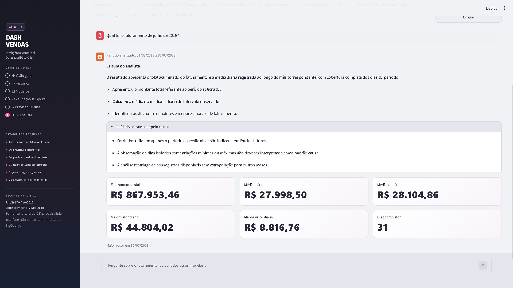
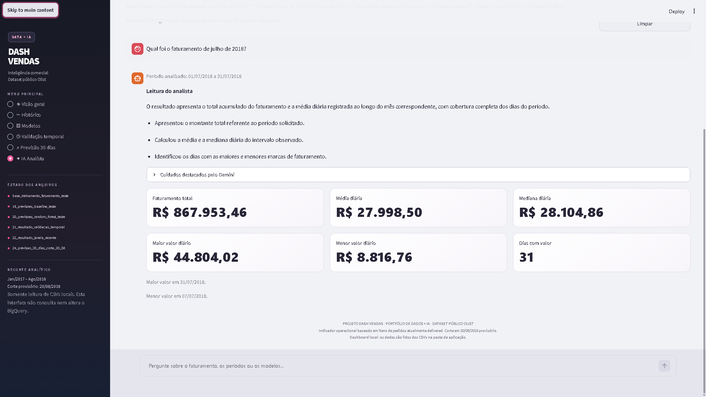
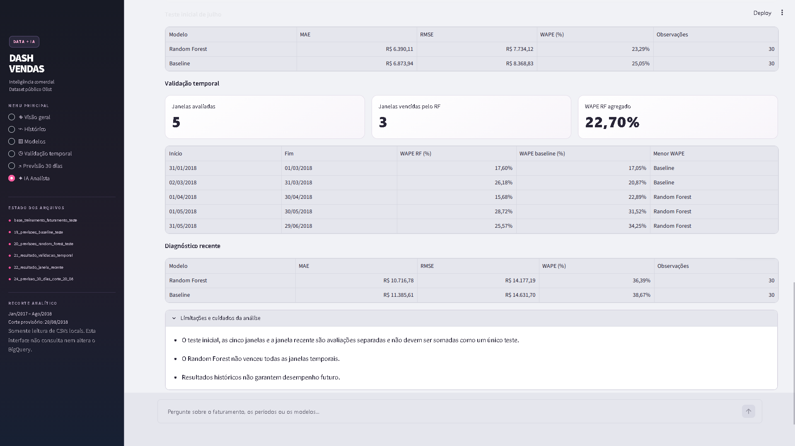
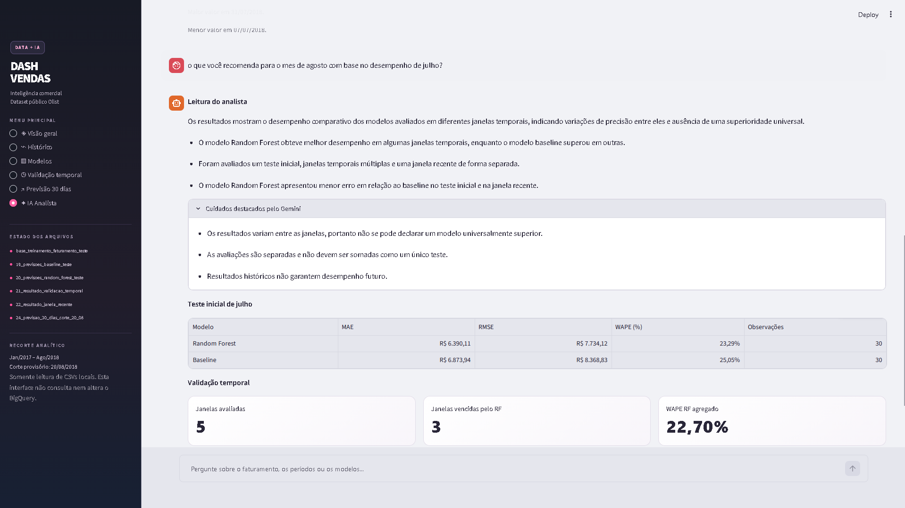

<!--
  README de perfil: jessicaprataborgesadm
  Identidade: roxo, preto e branco | Dados, Automação e Desenvolvimento
-->

# Jéssica Prata Borges

### Dados • Automação • Desenvolvimento de Soluções

**Transformo dados e processos em soluções práticas para apoiar decisões e simplificar rotinas.**

---

## ✦ Sobre mim

Sou estudante de Ciência de Dados e atuo na interseção entre **análise de dados, automação e tecnologia**. Gosto de entender o problema antes de escolher a ferramenta, estruturar informações confiáveis e transformar necessidades operacionais em soluções úteis.

Minha experiência reúne rotinas administrativas e financeiras, análise de indicadores, construção de dashboards, automações e desenvolvimento de aplicações.

- 📊 Análise de dados e indicadores de negócio
- ⚙️ Automação de processos e integração de ferramentas
- 🧩 Modelagem, qualidade e organização de dados
- 🤖 Exploração de IA aplicada a problemas reais
- 💻 Desenvolvimento de soluções e aplicações

## ✦ Experiência profissional

### Grupo Boticário
**Estágio Administrativo | Performance Industrial, Dados e Automação**  
*2025 – atual*

Atuação em Performance Industrial e Excelência Operacional, conectando análise de dados, indicadores fabris, automação e desenvolvimento de soluções para apoiar a operação e a tomada de decisão.

- **Engenharia e análise de dados:** consultas, exploração e tratamento de bases utilizando SQL e Google BigQuery.
- **Análise de ordens de produção:** triagem de ordens fabris com SQL, Python e JavaScript, identificando antecipadamente informações ausentes ou inconsistências antes do fechamento.
- **Indicadores industriais:** acompanhamento e análise de KPIs, OEE, ordens de produção e dados provenientes de sistemas MES, identificando desvios, padrões e oportunidades de melhoria em apoio à Engenharia.
- **Business Intelligence:** desenvolvimento de dashboards gerenciais no Looker Studio para acompanhamento de indicadores e desempenho operacional.
- **Automação e integração:** criação de soluções com Google Apps Script, JavaScript e HTML para integrar, tratar e atualizar informações, reduzindo etapas manuais.
- **Soluções para processos internos:** desenvolvimento de ferramentas com Google Sheets e AppSheet para controles e acompanhamento de informações.
- **IA aplicada:** exploração de agentes e Gems no Gemini para apoiar análises, automações, construção de dashboards e desenvolvimento de código.
- **Sistemas corporativos:** utilização de SAP R/3 e S/4HANA em rotinas administrativas e financeiras.

### Santander
**Experiência bancária | Especialista Santander II (GNS2)**  
*Experiência de aproximadamente 3 anos*

Atuação com atendimento e relacionamento com clientes, atividades comerciais e operacionais, além de organização e acompanhamento de eventos internos e externos.

- Atendimento e relacionamento com clientes, identificação de necessidades, negociação e resolução de demandas.
- Apoio à experiência do cliente e orientação sobre produtos, serviços e canais de atendimento do banco.
- Apoio às rotinas operacionais e ao fluxo de atendimento da agência.
- Organização e acompanhamento de eventos internos e externos, considerando infraestrutura, acessibilidade, segurança, conforto, circulação de pessoas e adequação do espaço aos objetivos.
- Avaliação de locais e comparação de orçamentos para apoiar a escolha de espaços e o planejamento dos eventos.
- Articulação com diferentes interlocutores, alinhamento de necessidades e acompanhamento de entregas e prazos.
- Desenvolvimento de competências em comunicação, negociação, organização, senso de urgência e resolução de problemas.

---

## ✧ Projetos em destaque

### 🤖 Dash Vendas | Forecasting & IA Analista
**Data Analytics • Machine Learning • LLM • Inteligência Comercial**

Projeto de portfólio desenvolvido com dados públicos do e-commerce brasileiro da Olist. Integra análise de faturamento, engenharia de dados, comparação de modelos preditivos e uma camada conversacional de IA generativa para apoiar a interpretação dos resultados.

**Galeria do projeto**

**01 · Validação temporal dos modelos**

**02 · IA Analista com Gemini**

**03 · Consulta conversacional de faturamento**

**04 · Indicadores e detalhamento da resposta**

**Diferencial: IA Analista com LLM (Google Gemini)**  
A aplicação permite fazer perguntas em linguagem natural sobre os dados e recebe uma leitura contextual dos resultados, com explicações, pontos-chave e cuidados de interpretação. O LLM atua como camada narrativa: os indicadores, métricas e cálculos continuam sob responsabilidade do motor determinístico em Python, evitando delegar ao modelo a produção dos números.

**Fundação analítica e preditiva:** camada RAW no BigQuery, consultas SQL, construção de série diária, engenharia de features, comparação entre baseline e Random Forest e validação temporal em cinco janelas históricas.

**Destaque técnico:** no resultado agregado das cinco janelas, o Random Forest apresentou WAPE de 22,70%, contra 25,27% do baseline. O dashboard Streamlit é executado localmente e não consulta o BigQuery em tempo real.

**Stack:** Python · SQL · BigQuery · Pandas · Scikit-learn · Streamlit · Google Gemini API · LLM (IA generativa)

---

### 📈 Dados & Analytics | Performance em Venda Direta
**Business Intelligence • Qualidade de Dados • Indicadores**

Estudo demonstrativo com dados, marcas e valores sintéticos. Analisa performance por ciclo, conciliação entre realizado e orçamento, produtividade e mix de produtos, com validações de qualidade e atenção à granularidade dos indicadores.

**Stack:** Python · Pandas · SQL · BigQuery · Streamlit · Plotly

---

### 🧊 Trade Marketing 3D Analytics
**Simulação de Cenários • Visualização 3D • Estratégia de Varejo**

Aplicação interativa que combina análise de dados e renderização 3D para simular cenários A/B no varejo, explorando impactos de descontos e variações climáticas sobre o lucro incremental.

**Stack:** Python · Pandas · Streamlit · Three.js · WebGL

## ✧ Projetos em desenvolvimento

- **Anti-Spam Android:** aplicação com regras configuráveis para identificação de chamadas, processamento local e armazenamento SQLite.
- **CineXP:** aplicação Android voltada à descoberta de filmes e séries, comunidade e gamificação.

## 🛠️ Ferramentas e tecnologias

**Dados & Analytics**  
   

**BI & Visualização**  
   

**Automação & Cloud**  
 

**Desenvolvimento**  
   

## ✦ O que valorizo

- Qualidade e consistência dos dados
- Soluções simples, documentadas e sustentáveis
- Automação com responsabilidade e segurança
- Análises que deixam claras as premissas e limitações
- Aprendizado contínuo e colaboração

---

### Vamos trocar ideias?

Gosto de conhecer projetos, compartilhar aprendizados e colaborar em soluções que conectem dados e tecnologia.

**Obrigada pela visita! 💜**

